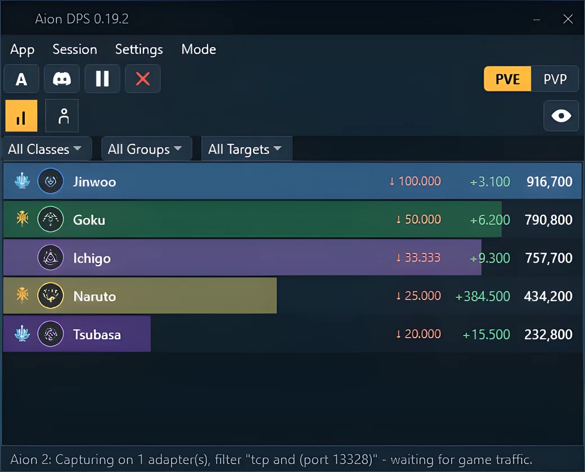

# Real-Time Combat Analytics & Overlay — Video Tool

  

---

Aion-DPS-Meter turns your AION 2 session into a live, readable feed: damage and healing per player, skill breakdowns with crit rates, and share bars that update as the fight unfolds. The overlay stays click-through while the numbers do the work — pin it over the client, glance at it between casts, and let boss casts, timers and world boss respawns announce themselves. Passive Npcap capture feeds every panel, so the meter sees the fight without ever touching the game process. Free and open source, it keeps the whole readout on your own screen and off your rotation.

## Features

**Live damage and healing for everyone.** Every player in your party or raid with name, total damage, DPS and a share bar; faction and class as icons. Filter by class, group or target. A **Mob/Boss** filter switches between overall DPS and true per-target **iDPS**, bosses recognised from the game's own data and shown by name. A **PvE/PvP** switch keeps the two apart, and a wipe on a boss gets its own entry, marked with a skull.

**Five views, one click apart.** **Damage**, **Heal**, **Damage taken** and two **All in One** views. Switch with a hotkey or by clicking the mode label; *All in One* puts damage taken, healing and total side by side, *All in One Compact* tucks healing and damage taken into a small second line under the name.

**A click-through overlay.** **Hide UI** shrinks the window into small chips or a compact panel that sits on top of the game without taking a single click. Opacity, share bars, the boss's health and damage taken per player are all options, and it only draws while the game is in front. An optional setting lets the meter and its overlays step aside while the game's own menus are open, then come back when you close them.

**The full story behind every number.** Double-click a player for every skill with hits, crit rate, total, min, max and average, split by target, plus a DPS curve over the whole fight. Crit rates come straight from the server's hit data, so they're exact, and each skill shows how its hits landed — Back, Front, Perfect, Double and Multi — as a share of its direct hits.

**Rotation, effects and stagger.** A timeline draws every skill a player used at the moment they used it: support skills up top, damage below, weaves one row lower so a run of them reads as a staircase, with the player's DPS and the monster's staggers behind it. Drag to move through the fight, zoom with the wheel, hover for details, and read the opener and rotation-in-short underneath. The **Buffs** tab lists every effect with its uptime, how much of it the player kept up themself, and who else pitched in.

**Replay a boss fight from above.** Your group as class-coloured dots with the last seconds of their walk, the boss with the way it faces and its health, wind-up areas glowing amber then landing red, a ring on whoever got hit, the dead crossed out — all over a timeline of big attacks, hits, deaths, staggers and boss health. Play, pause, scrub and zoom; a fight keeps its replay in your local history.

**Your whole character at a glance.** Gear with item level and enchant (Amplify stage above +15 included), arcana, species knowledge, every skill with its level and the full Daevanion boards. The meter notices which **skill preset** is active and keeps every one it has seen, stones and stigma effects included, in the game's own words.

**Interactive map with pets and gathering.** Your position, the spawn points of the pets you're after and the gathering spots you switched on — herbs, ores, wood, gems — without alt-tabbing. Only what your faction can use is listed, edge arrows point to the nearest target, and the last known position stays put while the game is closed. The pet list covers every region with your own pet level plus a **Rare** tab, and inside a dungeon the map switches to that instance.

**Event timetable with reminders.** An overlay lists what's next — Battlefield, Abyss sieges, the Shugo Festival, the Beritra Air Raid, the Spacetime Rift and more — with a sound and volume per event and a reminder a few minutes ahead. Times follow the game server's UTC clock, so they read the same in every region, and are shown in your PC's time.

**World bosses on your overlay.** Switch on a field boss to see its timer on the overlay and hear its sound the moment it's up, with times straight from the game. Sound and volume are set per boss, grouped by region.

**Network overlay.** Ping, jitter, traffic, packet loss and time online, measured from the traffic your PC already receives, turning green to red as the connection worsens. Pick your lines, lock it in place, toggle it with a hotkey. A **Network report** can save the last 15 minutes as a diagnostic file, or send it on, with a box showing exactly what goes and what stays.

**Combat overlay.** A transparent frame with up to three elements you place and size yourself: a **boss cast bar** with the skill name, a countdown, its target and **AREA**/**LETHAL** flags the meter learns over time; a **target of the target** block with picture, name and health, plus an optional healer bar; and optional **voice announcements** for boss casts, even with the overlay off. Locked, it's click-through and only shows while the game is in front.

**Loot, attributes and the daily checklist.** The **Tools** window gathers the extras: **Loot** shows what you pick up from the ground, by session and map, as a page or an overlay; **Attributes** draws the attribute ring, explains every stat and adds up your bonuses; the **checklist** keeps daily and weekly tasks, reads the mandatory quests and weekly Odyle purchase from the game and leaves the rest to tick by hand. Every tool remembers its own size.

**Session history that stays yours.** Fights, loot and statistics are kept locally so you can look back on a run long after it ended — saved sessions that include rotation data bring their timeline back when loaded.

**Built to be safe and to stay free.** Passive packet capture through Npcap, no memory reading, no injection, nothing sent unless you choose to. Free, open source under MIT, and it updates itself.

## How it works

At its heart, Aion-DPS-Meter listens. The game sends its combat story across your network as it happens, and the meter reads that traffic on your own machine through the Npcap driver — quietly, passively, without ever sending a packet back or reaching into the game's process or memory. Every hit, heal, buff and stagger arrives this way, and the meter turns each one into a picture you can read at a glance.

The flow is simple and stays out of your way. Start the meter, log in, and the game introduces your character — gear, skills, Daevanion boards, the server you play on — all pulled from that same stream. From there the meter follows the fight as it unfolds: players and bosses recognised from the game's own data, damage and healing tallied live, skills counted as they land. Nothing leaves your machine unless you ask it to.

What you see depends on the moment. In the thick of it, a click-through overlay of chips or a compact panel floats over Aion 2 without stealing a single click, drawing only while the game is in front. Pop open the main window and five views sit one hotkey apart — damage, healing, damage taken, and two all-in-one layouts — each with share bars, class icons, and a PvE/PvP switch to split the chaos. Double-click a player and the fight unfolds into a skill breakdown with exact crit rates, a DPS curve, and a rotation timeline that reads like a staircase of weaves. In the player window of a boss fight, Replay lifts the whole encounter into a top-down view: your group as class-coloured dots, the boss's wind-up areas glowing amber before they land, a timeline you can scrub to any second.

Between the fighting, the meter keeps the wider world in view. The map overlay draws your position beside pet spawn points and gathering spots, switching to an instance map the moment you step inside one. The event timetable counts down to sieges and festivals with the sound you chose, world boss timers ride on the overlay so you hear the moment one is up, and the network overlay reads your connection's health from traffic already flowing. The combat overlay watches bosses wind up their casts and can call them out by voice; the loot log, attribute ring, stat calculator and daily checklist round out the toolkit. Everything remembers where you left it, and every overlay only draws while you are actually in the game.

Behind the scenes the passive capture pays off twice: because the meter reads the server's own hit data rather than guessing, crit rates are exact, and because it learns each skill's shape — area or not, when its damage lands, how big its reach — it carries that knowledge from one fight into the next, remembering boss attacks and replay sizes between sessions so each encounter reads a little clearer than the last.

## Workflow

Land in a fight and watch the meter wake up. The moment your group pulls, **every player appears with their own bar** — damage climbing, healing ticking, share bars sliding against each other in real time. No setup, no log to start, no addon to load. The capture is already listening; you just play.

**One window, five faces.** Tap the mode label or hit the hotkey and the same table flips between **Damage**, **Heal**, **Damage taken**, and the two **All in One** views that stack taken, healed and dealt side by side. Keep the click-through **overlay chips** floating over Aion 2 so the numbers sit right on the fight — and never steal a click from your rotation.

**Pull one player out of the pack.** Double-click a name and the window alternatives open: a **skill breakdown** with hits, crit rate and damage ranges, a **DPS curve** tracing the whole fight, a **rotation timeline** where support skills ride above damage skills and weaves step down into a staircase, and a **buff uptime** list that shows who kept what alive. Drag along the fight, zoom with Ctrl + wheel, hover any icon to read that exact moment.

**Then rewind the fight itself.** Open the **Replay** tab on a boss and the arena rises from above — your group as class-coloured dots, the boss turning to face its target, amber areas winding up and snapping red as they land, a red ring on whoever got hit. Scrub the timeline, drop it to half speed or race it at four times. Watch the mistake before you make it again.

**Let the game talk while you focus.** Boss casts slide into the **combat overlay** with a draining bar and a name attached, floored with **AREA** and **LETHAL** tags; a Windows voice can call them out even with the overlay hidden. The **target of the target** block tells you who the boss has chosen. Field bosses tick down on the overlay and chime the instant they spawn.

**And between pulls, the rest of the toolkit.** Glance at the **map** for pet spawns and gathering nodes with edge arrows pointing the way, check the **event timetable** before the next siege, open the **Character** window to see gear, arcana, skills and Daevanion boards exactly as the game sent them, or run a stat swap through the **calculator** before you commit a stone.

When the session ends, **save it, review it, share it** — sessions keep their rotation data and reopen later, and boss fights can go to the leaderboards if you choose. The meter watches, you decide.

## 📸 Screenshot

## Requirements

**Windows, and only Windows.** The meter is built for Windows 10 and 11 on a normal desktop or laptop — no other platform is on the roadmap, because the whole thing hangs off Windows' own packet plumbing.

**The Npcap driver, installed once.** This is the only thing you have to bring yourself; it is not bundled with the meter. Npcap is the capture driver that lets the meter *see* the game's traffic at all. Install it first, then the meter — the other way round works too, but nothing will light up until the driver is there.

**A tiny footprint while you play.** Installed per user, no administrator rights, no .NET runtime, no background services to babysit. Start it, log in with your character, and the meter recognises your character, gear, skills and server on its own — no setup wizard, no config file to hand-edit.

**For each overlay you switch on, a display.** The meter window, the click-through chips, the boss cast bar, the target-of-target block, the network panel, the loot ticker and the map all draw on top of the game — the more of them you keep on, the more screen real estate you're spending. Every one can be placed, sized and switched off on its own.

**For the map and world bosses: having been there.** Timers and pet spawns arrive with the game's traffic for the map you're standing on. Yours appear; the rest fill in the first time you visit those maps.

**A sound output, if you want the voice.** Boss-cast announcements and event reminders use the Windows voice you pick under Settings — mute them or keep them, per overlay and per boss.

**Your own machine, and nothing further.** The meter reads traffic that is already arriving at your PC. Nothing about your play leaves it unless you explicitly upload (off by default), and the only other thing it sends is a version check that can be switched off entirely.

## FAQ

**Why does the meter need Npcap, and what does it actually do with it?**
Npcap is the little driver that lets Windows hand a copy of the game's network packets to the meter. That's the whole trick: the meter reads the traffic your client already receives, the same way a passenger reads a map over the driver's shoulder. It never sends anything, never injects, never touches the game process. Install the driver once and forget it exists.

**Will this get me flagged or banned?**
The capture is passive and the meter never reads or writes game memory, which is the line most anti-cheat systems care about. Still, third-party tools are always a personal judgement call — play the way you're comfortable playing, and keep the overlay click-through so it never interferes with the game.

**I launched the meter but no numbers appear. What's the visual flow I should expect?**
Log your character in *after* starting the meter. The moment your client starts talking to the server, names, classes and skill icons should populate the window like a spreadsheet waking up. If the table stays grey, check that Npcap installed correctly and that you're capturing on the right adapter — the meter usually picks the active one by itself, but a VPN or a second network card can confuse it.

**My skill icons look wrong on Korea or Taiwan servers. Why?**
The global release and the eastern clients aren't on the same patch rhythm — Korea and Taiwan run a few versions ahead. Skill recognition there may be partial or labelled as a guess. The core damage and healing numbers still flow; it's the pretty pictures that lag behind.

**The overlay is covering my cast bar. Can I make it smaller, or make it disappear entirely?**
Yes, and it's designed to be sculpted, not just toggled. Drag it to a corner, lower its opacity, switch to chips or the compact panel, or use the "Hide during game menus" option so it politely steps aside whenever you open your map or inventory. Everything is a slider or a checkbox — nothing requires editing a config file.

**Can I see a fight again after it's over?**
Double-click the player or open the boss fight and hit **Replay** — your group plays back as coloured dots around the boss, with its winding-up attacks painted on the ground. Older sessions captured by earlier versions won't have a replay; the data simply wasn't recorded then. Newer fights keep theirs in the local history.

**Does any of this leave my PC?**
Only if you tell it to. Uploads to the leaderboards are off by default; the network report and the stat-calculator recording both show you exactly what's inside before anything is sent, and neither includes your character name, legion, or IP address. The one thing that talks to the outside world on its own is the update check, and even that can be switched off.

**What are the requirements, in plain terms?**
Windows, the Npcap driver, and AION 2 running while you play. No .NET runtime to hunt down, no administrator rights to beg for — it installs into your user profile and starts itself.

**Hotkeys keep colliding with my game binds. Can I change them?**
Every hotkey is rebindable in the settings. Pick something your fingers won't trip over mid-boss-fight, and if you ever forget the defaults, the mode switch, overlay toggle and combat overlay each have their own line in the settings window.

## License

Aion-DPS-Meter is free, open source, and stays that way under the MIT license. In practice that means you can use it, read it, fork it, learn from it, and shape it into whatever your own workflow needs — a quieter overlay, a custom view, a workflow tweak that only makes sense to you. The source is the source of truth: every panel, every timer, every pixel of the overlay is yours to inspect and remix.

What the license doesn't do is grant access to the game or its data. Npcap is a separate driver with its own terms, and AION 2 belongs to NCSOFT — the meter only listens to traffic already arriving on your machine and never touches the game itself. Keep that boundary in mind when you build on top of it: extend the tool, not the game.

If you ship a modified build to your guild or your community, keep the license notice and the credit intact, and be honest about what you changed. The project grows best when forks stay recognizable as forks — same spirit, different canvas.

